# Informe de avance de la Parte 1

**Sistema de monitoreo terrestre preventivo del cultivo de tomate Sabueso**

**Autores:** Cristian Huanca y Cristhian Sanchez. **Asignatura:** Proyecto IV. **Entrega:** 07 de octubre de 2026.

# I. INTRODUCCIÓN

Sabueso es un sistema de monitoreo terrestre preventivo del cultivo de tomate para el predio Pampa Concordia, en Arica. Su propósito es transformar los recorridos de inspección en registros consultables por hilera y zona, mediante imágenes capturadas con el robot cuadrúpedo Unitree Go2 y análisis visual de frutos, maleza y follaje.

Este informe presenta el avance de la Parte 1 de Proyecto IV, con entrega el 07 de octubre de 2026. Desarrolla los diez aspectos de la rúbrica: problema, objetivos y planificación, metodología, requisitos, contexto, casos de uso, comportamiento, proceso de negocio, prototipo de interfaces y verificación con el cliente. Los modelos describen el sistema propuesto; las pruebas del producto corresponden a etapas posteriores.

# II. DESARROLLO

## 2.1. Problema y alternativas de solución

Pampa Concordia produce tomate bajo invernadero. Según el documento inicial del proyecto, el seguimiento del cultivo se realiza mediante recorridos manuales, observación directa y anotaciones no sistemáticas. Este trabajo exige revisar frutos y follaje a corta distancia y dificulta conservar evidencia comparable entre visitas.

El problema central es la falta de información visual organizada para localizar y seguir los hallazgos del cultivo. Sus efectos son la detección tardía de signos visibles de deterioro, la ausencia de conteos de frutos por madurez, la pérdida de antecedentes y la dificultad para decidir dónde concentrar una revisión o un tratamiento. El sistema busca apoyar esas decisiones; el agricultor conserva la responsabilidad de interpretar y actuar sobre la información.

Tabla 1. Evaluación cualitativa de las alternativas

| Alternativa | Ventaja | Limitación y decisión |
| --- | --- | --- |
| Reforzar la inspección manual | Aprovecha el conocimiento del personal y requiere poca inversión inicial. | Mantiene la dependencia del observador y no asegura registros consistentes. Se conserva como referencia de validación. |
| Sensores y cámaras fijos | Permiten observación continua de puntos definidos. | Su cobertura depende de la instalación; no sustituyen el recorrido de proximidad entre hileras. Pueden ser complementarios. |
| Robot terrestre Unitree Go2 | Acerca la cámara al cultivo y permite asociar capturas con una zona. | Requiere acceso de desarrollo, navegación viable y capturas útiles. Es la alternativa seleccionada por la disponibilidad del robot en el DICI. |

La selección debe comprobarse sobre el equipo disponible. La documentación oficial distingue el acceso de desarrollo y los accesorios según la versión del Go2 [1, 2]. Antes de integrar el software se verificará la variante del robot, el acceso a cámaras y LiDAR, y el espacio de circulación del invernadero. La literatura sobre conteo de tomate respalda el análisis de imágenes, pero también muestra la importancia de las oclusiones y de la adquisición de datos [3]; sus resultados no constituyen resultados de Sabueso.

## 2.2. Alcance y planificación del proyecto

### 2.2.1. Título y alcance del proyecto

Título del proyecto: Sistema de monitoreo terrestre preventivo del cultivo de tomate Sabueso.

El alcance comprende patrullaje autónomo entre hileras, captura HD a la altura del fruto, detección y clasificación de frutos verdes y maduros, detección de maleza y signos visibles de deterioro del follaje, registro de cada evento por hilera y zona, e interfaces de consulta del mapa, la ficha y el historial. Se mantienen RF1–RF6 y RFN1–RFN7 de la fase 0.

La unidad de trazabilidad es la combinación hilera–zona. La inspección observa plantas y frutos, pero no exige una identidad permanente de cada planta. El mapa es un esquema del sector que vincula resultados con zonas; la ubicación no presupone coordenadas satelitales.

Quedan fuera de los entregables obligatorios el monitoreo aéreo, la medición de suelo, la reconstrucción 3D del cultivo, la aplicación automática de agroquímicos y el diagnóstico de enfermedades por especie. Los signos visibles se presentan como hallazgos para revisión. El tamaño físico del piloto se acordará con el cliente; la condición de consulta con al menos 200 zonas de RFN4 se conserva.

### 2.2.2. Objetivo general y objetivos específicos

Objetivo general: desarrollar, durante el semestre de Proyecto IV, un prototipo integrado de monitoreo terrestre del cultivo de tomate mediante el Unitree Go2, que genere evidencia visual, conteos por madurez y registros de anomalías consultables por hilera y zona, de acuerdo con los requisitos y los criterios de aceptación del cliente.

Tabla 2. Objetivos específicos y evidencias de aceptación

| ID | Objetivo específico | Evidencia prevista |
| --- | --- | --- |
| OE1 | Integrar patrullaje entre hileras y captura HD con identificación de zona. | Recorrido y capturas vinculadas; RF1, RF2 y RFN5. |
| OE2 | Detectar, clasificar por madurez y contar frutos visibles. | Comparación con conteo manual; RF3 y RFN2. |
| OE3 | Detectar maleza y signos visibles de deterioro del follaje. | Evaluación con capturas etiquetadas; RF4, RF5, RFN1 y RFN3. |
| OE4 | Registrar hallazgos y permitir consultar mapa, ficha e historial por zona. | Eventos identificados y consulta verificable; RF6, RAN3, RAN4, RFN4 y RFN6. |
| OE5 | Validar el funcionamiento y documentar un despliegue reproducible. | Revisión con el cliente, métricas y prueba de instalación; RFN1–RFN7. |

### 2.2.3. Planificación temporal

La carta Gantt organiza dieciséis semanas lectivas desde el 17 de agosto hasta el 07 de diciembre de 2026, con el receso del 14 de septiembre. Las fechas evaluativas se toman de la rúbrica: Parte 1 el 07 de octubre, Parte 2 el 28 de octubre y Parte 3 antes de finalizar noviembre. Las barras indican planificación, no porcentaje de avance ejecutado.

Figura 1. Carta Gantt de las actividades propuestas del semestre

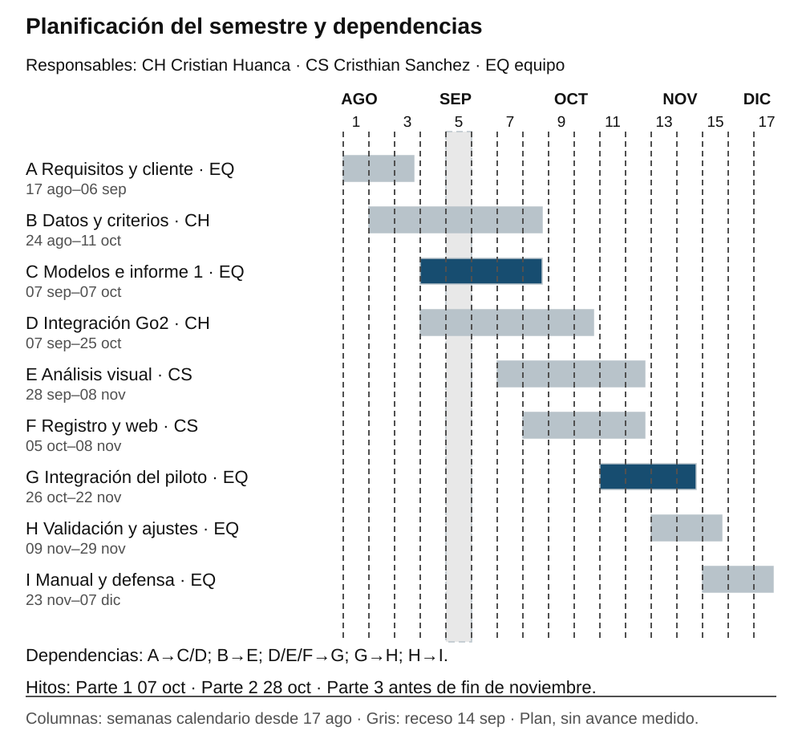

El equipo de Cristian Huanca y Cristhian Sanchez revisará semanalmente la planificación. Para integrar el sistema se requiere disponer primero de capturas identificadas; para validar los modelos se necesita un conjunto etiquetado independiente; y la validación final exige navegación, análisis y consulta integrados. La revisión del cliente condiciona los ajustes de alcance.

## 2.3. Metodología de desarrollo de cara al cliente

Se propone Kanban con prototipado evolutivo. La variabilidad de las capturas, la disponibilidad del robot y los acuerdos con el agricultor aconsejan gestionar el trabajo mediante entregas pequeñas y revisión continua. Kanban requiere un flujo explícito, control del trabajo en curso y mejora del proceso a partir de su comportamiento [4].

Tabla 3. Flujo y políticas del tablero Kanban

| Estado | Política de trabajo |
| --- | --- |
| Pendiente | Registrar necesidades y relacionarlas con un requisito. El cliente prioriza el valor de uso. |
| Lista | La tarea tiene responsable, alcance, dependencia y criterio de aceptación definidos. |
| En curso | Límite propuesto de dos tareas activas para el equipo de dos integrantes. |
| Revisión | Límite de una tarea en revisión. Comprobar evidencia y solicitar revisión del cliente cuando corresponda. |
| Finalizada | Existe evidencia verificable, se resolvieron observaciones y el cambio aceptado quedó documentado. |

Se realizará una reunión breve del equipo para revisar bloqueos y, como propuesta de coordinación, una demostración semanal o en la oportunidad acordada con el cliente. Cada demostración tendrá una pregunta concreta: si la ficha permite ubicar el hallazgo, si el estado del mapa se entiende o si los resultados apoyan la inspección. Las observaciones se convertirán en tareas priorizadas, sin cambiar requisitos de forma implícita.

El prototipo evoluciona desde la secuencia de pantallas de esta entrega hacia componentes funcionales. Una tarea se considera lista para revisión cuando se puede demostrar su criterio de aceptación; se considera finalizada cuando la evidencia es suficiente y las observaciones pertinentes se incorporaron. Se registrarán tareas bloqueadas, tiempo de ciclo y tareas terminadas para ajustar la carga de trabajo. Estas políticas son propuestas de aplicación al proyecto, no resultados medidos.

## 2.4. Requisitos de alto nivel

### 2.4.1. Necesidades principales del sistema

Los requisitos de la fase 0 son la línea base. Se conserva su identificación para que los objetivos, los casos de uso y las verificaciones se puedan relacionar con el mismo documento. Las necesidades de alto nivel se expresan de la siguiente manera:

Tabla 4. Necesidades de alto nivel del proyecto

| ID | Necesidad |
| --- | --- |
| RAN1 | Detectar tempranamente anomalías visuales del cultivo, como maleza y signos de deterioro observables en las capturas. |
| RAN2 | Apoyar la estimación del estado productivo mediante el conteo de frutos por madurez. |
| RAN3 | Mantener evidencia fotográfica e historial de alertas por hilera y zona. |
| RAN4 | Presentar un mapa o esquema visual del estado registrado del cultivo por hileras y zonas. |

La prevención se entiende como apoyo a una revisión oportuna de signos visibles. Las imágenes HD no justifican prometer la detección de alteraciones que todavía no sean observables. Del mismo modo, el conteo de frutos visibles es una medida de apoyo y no equivale por sí solo a una predicción validada de toneladas de cosecha.

### 2.4.2. Requisitos funcionales

Tabla 5. Requisitos funcionales de la línea base

| ID | Requisito | Comportamiento requerido |
| --- | --- | --- |
| RF1 | Patrullaje autónomo entre hileras | Recorrer las hileras utilizando navegación LiDAR y evasión de obstáculos. |
| RF2 | Captura HD a nivel de planta | Capturar video e imágenes HD a la altura del fruto durante el recorrido, asociados con la hilera y la zona. |
| RF3 | Conteo de frutos | Detectar y clasificar frutos verdes y maduros en las imágenes, y obtener su conteo. |
| RF4 | Detección de maleza a ras de suelo | Identificar maleza entre hileras y registrar la hilera y la zona correspondiente. |
| RF5 | Detección visual del deterioro | Identificar signos visibles de manchas, decoloración o marchitez mediante las imágenes HD. |
| RF6 | Trazabilidad por hilera y zona | Registrar cada evento con un identificador único y asociarlo a su hilera, zona y evidencia. |

### 2.4.3. Requisitos no funcionales

Tabla 6. Requisitos no funcionales y métodos de verificación

| ID | Condición de aceptación | Verificación prevista |
| --- | --- | --- |
| RFN1 | Precisión superior al 85 % y exhaustividad (recall) superior al 80 % para maleza y deterioro. | Comparar detecciones con un conjunto etiquetado de validación. |
| RFN2 | Error de conteo inferior al 10 % respecto del conteo manual. | Comparar frutos contados automáticamente y manualmente sobre las mismas zonas y condiciones. |
| RFN3 | Tasa de falsos positivos de alertas inferior al 15 % en pruebas de campo. | Contrastar las alertas con la revisión de referencia y registrar el denominador usado. |
| RFN4 | Consulta de ficha en menos de 2 segundos, con al menos 200 zonas registradas. | Medir el tiempo de respuesta de la ficha bajo esa carga de datos. |
| RFN5 | Velocidad inferior a 1 m/s y detención automática ante obstáculos a menos de 0,5 m. | Verificar desplazamiento y detención en un entorno de prueba supervisado. |
| RFN6 | Interfaz comprensible para personal agrícola sin formación técnica. | Observar tareas de consulta con el cliente y corregir dificultades de uso. |
| RFN7 | Un tercero replica el despliegue con repositorio y manuales en menos de 4 horas. | Registrar tiempo y dificultades de una instalación siguiendo la documentación. |

Los umbrales son exigencias del proyecto, no resultados ya alcanzados. Antes de evaluar los modelos se fijarán la definición de cada métrica, el procedimiento de conteo, el tratamiento de zonas sin frutos y los criterios de anotación. El conjunto de validación se separará del usado para entrenar, evitando que capturas casi idénticas del mismo recorrido se repartan entre ambos conjuntos. RFN4 se implementa en la ficha de zona, coherente con la unidad de trazabilidad acordada.

### 2.4.4. Ambiente del software y responsabilidades

El ambiente comprende el robot y sus sensores, el invernadero organizado en hileras y zonas, el operario que prepara y supervisa la misión, el agricultor que consulta los hallazgos, y los recursos de cómputo y comunicación disponibles para procesar y consultar la información. La cámara RGB aporta evidencia visual; el LiDAR apoya navegación y localización relativa. No se requiere un sensor multiespectral para los requisitos definidos.

Tabla 7. Subsistemas y contratos de información de alto nivel

| Subsistema | Responsabilidad | Entrada y salida |
| --- | --- | --- |
| S1 Navegación y captura | Gestionar el recorrido, adquirir capturas e identificar la zona observada. RF1 y RF2. | Recibe misión y datos del robot; entrega capturas con fecha, hilera y zona. |
| S2 Análisis visual | Obtener conteos por madurez y hallazgos de maleza y follaje. RF3, RF4 y RF5. | Recibe capturas identificadas; entrega resultados y evidencia vinculada. |
| S3 Registro | Conservar eventos, identificadores, evidencia e historial. RF6. | Recibe resultados; entrega registros recuperables por hilera, zona y recorrido. |
| S4 Consulta web | Presentar mapa, ficha e historial al agricultor. RAN3 y RAN4. | Recibe consultas y registros; entrega información comprensible y estados sin datos. |

La distribución física del procesamiento y la selección de frameworks, base de datos y herramientas se definirán en la Parte 2. En esta entrega se exige que las capturas no pierdan su asociación espacial y que el sistema distinga entre información disponible, procesamiento pendiente y ausencia de datos. La comunicación fallida debe poder identificarse como una incidencia, sin presentar un recorrido incompleto como completo.

## 2.5. Modelo de contexto

La frontera del sistema delimita el software de Sabueso: navegación y captura, análisis visual, registro y consulta web. El robot es hardware externo que aporta sensores y locomoción; el operario y el agricultor son los actores humanos. El invernadero es el objeto de observación y la infraestructura de red y cómputo soporta la ejecución, sin convertirse por ello en actor del sistema.

Figura 2. Frontera del software y sus cuatro subsistemas

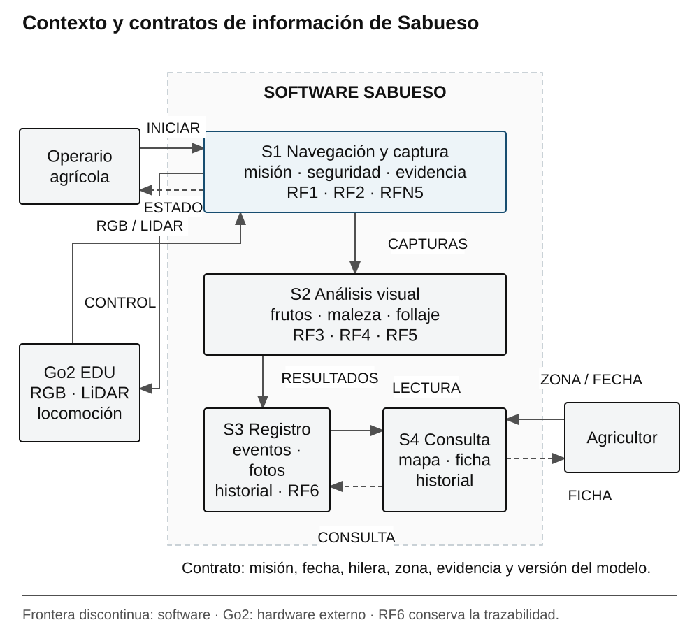

El intercambio con el robot incluye observaciones y órdenes de misión. Las capturas identificadas pasan al análisis, los resultados al registro y los registros a la consulta web. Esta separación permite comprobar cada responsabilidad sin fijar todavía una tecnología de implementación.

## 2.6. Modelo y descripción de casos de uso

Los casos de uso representan objetivos de actores externos. El operario inicia y supervisa el patrullaje; el agricultor consulta resultados, antecedentes y el mapa. El Go2 participa como soporte de captura y movimiento. El análisis visual y el almacenamiento son responsabilidades internas, no actores del sistema.

Figura 3. Objetivos del operario y del agricultor en Sabueso


Tabla 8. Casos de uso y trazabilidad con la línea base

| Caso de uso | Actor principal | Requisitos relacionados |
| --- | --- | --- |
| CU1 Ejecutar patrullaje | Operario agrícola; robot Go2 como soporte. | RF1–RF6; RFN5. |
| CU2 Consultar resultados de una zona | Agricultor. | RF3–RF6; RAN3; RFN4 y RFN6. |
| CU3 Consultar historial de una zona | Agricultor. | RF6; RAN3; RFN4 y RFN6. |
| CU4 Visualizar mapa del cultivo | Agricultor. | RAN4; RF6; RFN6. |

### 2.6.1. CU1 Ejecutar patrullaje

Actor y propósito: el operario solicita una misión para obtener evidencia y resultados del sector; el Go2 aporta sensores y locomoción.

Precondiciones: robot disponible y preparado, sector accesible, hileras y zonas identificadas, batería y comunicación con el control de misión verificables.

Flujo principal:

1. El operario selecciona el sector e inicia la misión.

2. El sistema comprueba condiciones de operación y valida la configuración del recorrido.

3. El robot se desplaza por las hileras; el software limita la velocidad y verifica obstáculos.

4. Mientras se desplaza, el sistema captura imágenes o video y asocia la evidencia con el recorrido, la hilera y la zona.

5. Se procesan las capturas para obtener conteos por madurez y hallazgos de maleza o deterioro visible.

6. El sistema registra los eventos con identificadores únicos y habilita su consulta cuando el procesamiento termina.

7. Se informa al operario el estado de cierre de la misión y las incidencias o zonas pendientes.

Alternativas y excepciones: si la batería o la configuración son insuficientes, no se inicia el recorrido y se informa la causa. Si se detecta un obstáculo a menos de 0,5 m, el robot se detiene. El operario solo reanuda tras comprobar condiciones seguras; en caso contrario cancela. Si una captura no puede asociarse con una zona, se marca para revisión y no se asigna a una ubicación inventada. Si falla la comunicación, se informa la incidencia y se preserva la evidencia adquirida para su recuperación.

Postcondición: las zonas recorridas tienen capturas y eventos identificados o una incidencia explícita. Una misión finalizada no implica necesariamente que el análisis ya terminó.

### 2.6.2. CU2 Consultar resultados de una zona

Actor y propósito: el agricultor revisa los conteos, hallazgos y fotografías de una zona para decidir una inspección o acción de manejo.

Precondición: la zona existe en el esquema del cultivo. El sistema puede tener resultados disponibles o indicar su ausencia.

Flujo principal: 1. El agricultor selecciona una zona del mapa. 2. El sistema recupera su ficha. 3. Se muestran fecha del recorrido, fotografías, conteos de frutos verdes y maduros, y hallazgos de maleza o follaje. 4. El agricultor examina la evidencia y puede abrir el historial.

Alternativas: si faltan capturas, aparece “Sin datos”; si el análisis está pendiente, se informa ese estado; si falla la consulta, se conserva la selección y se permite reintentar. El objetivo de tiempo de respuesta es inferior a 2 segundos con al menos 200 zonas, conforme a RFN4.

Postcondición: el agricultor conoce qué información existe para la zona y su fecha, sin confundir ausencia de información con ausencia de problemas.

### 2.6.3. CU3 Consultar historial de una zona

Actor y propósito: el agricultor compara la evidencia de la misma zona en distintos recorridos.

Precondición: la zona está identificada en el sistema; pueden existir uno o más registros o ninguno.

Flujo principal: 1. El agricultor abre “Historial” desde la ficha. 2. El sistema lista los recorridos por fecha. 3. El agricultor selecciona un registro. 4. El sistema muestra su evidencia y resultados conservando la identidad de hilera y zona. 5. Se vuelve a la ficha sin perder la selección.

Alternativas: si no hay antecedentes, se informa “Sin registros anteriores”. Si una imagen no está disponible, el registro mantiene sus metadatos y comunica la incidencia. Los valores de un recorrido no reemplazan los de otro.

Postcondición: el agricultor consulta antecedentes trazables y puede reconocer cambios observados entre visitas.

### 2.6.4. CU4 Visualizar mapa del cultivo

Actor y propósito: el agricultor localiza zonas con información o hallazgos y decide qué ficha revisar.

Precondición: existe una estructura de hileras y zonas correspondiente al sector de trabajo.

Flujo principal: 1. El agricultor accede al mapa. 2. El sistema presenta las hileras y las zonas con fecha o recorrido de referencia. 3. Cada zona muestra un estado textual, reforzado mediante color. 4. El agricultor selecciona una zona y abre su ficha.

Alternativas: una zona sin observación se muestra como “Sin datos”; los recorridos pendientes o incompletos se distinguen de los disponibles. Si cambia la fecha de consulta, el mapa se actualiza de forma coherente con ese recorrido.

Postcondición: el agricultor ubica una zona y accede a su información sin depender exclusivamente del color.

## 2.7. Diagramas de comportamiento

Los estados describen el ciclo y las interrupciones de una misión. Las secuencias representan el intercambio de información entre los participantes del patrullaje y de la consulta.

### 2.7.1. Estados de la misión

“En patrullaje” integra navegación y captura. Ante un obstáculo, la misión se detiene; el operario puede reanudarla si verifica condiciones seguras o cancelarla. El análisis visual es una actividad del software posterior a la adquisición.

Figura 4. Estados del patrullaje y transición ante obstáculos

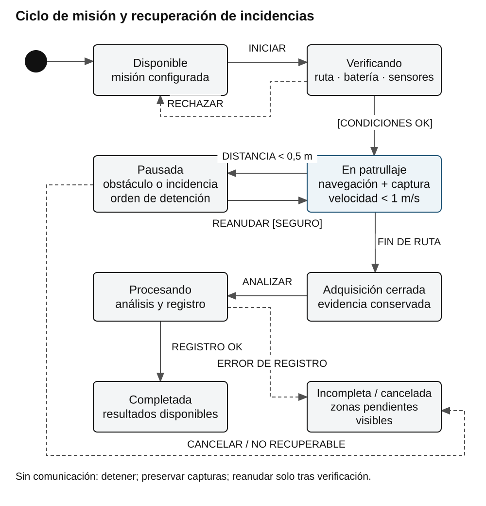

### 2.7.2. Secuencia de patrullaje y registro

El control de misión verifica el Go2 y repite el recorrido y la captura por zona. Después solicita el análisis visual y el registro de los resultados, conservando la evidencia y la ubicación. Los cinco participantes representan responsabilidades, sin fijar el equipo donde se ejecuta el procesamiento.

Figura 5. Interacciones principales de CU1 por zona

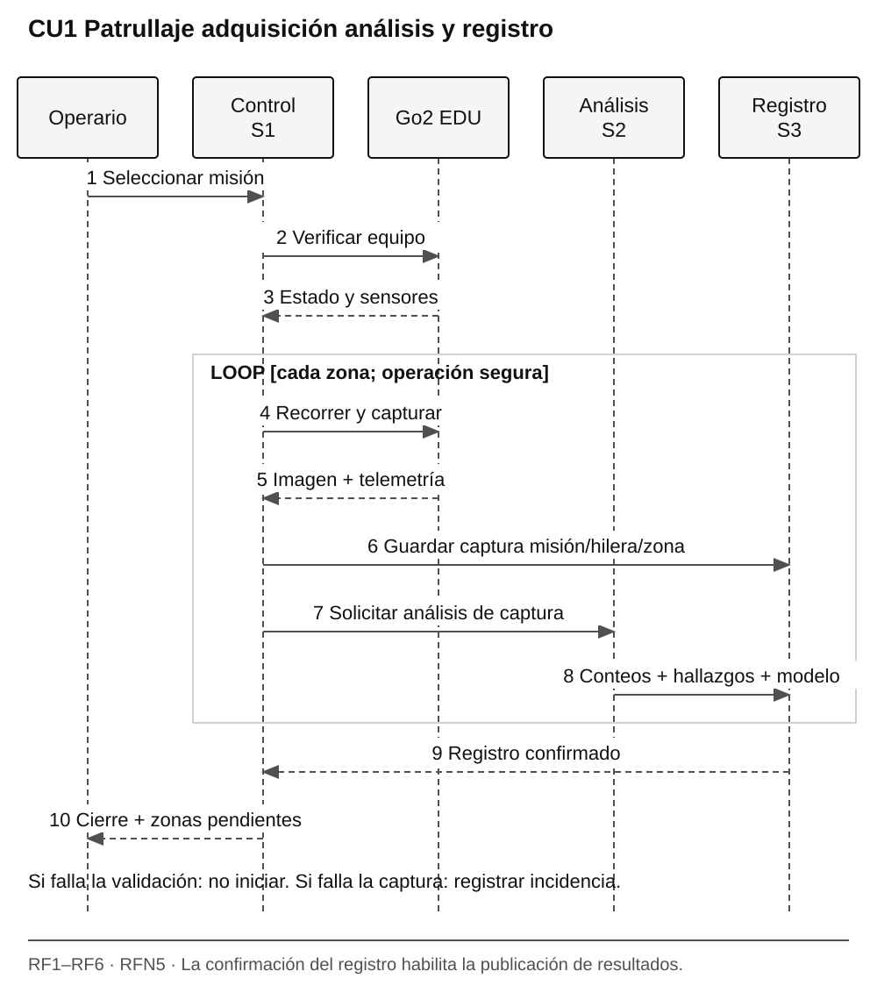

La batería insuficiente y los obstáculos se cubren en CU1 y en los estados. Ante una incidencia, el control informa el cierre incompleto y mantiene las zonas pendientes. Un conteo o una alerta solo se publican como resultado cuando el registro correspondiente está disponible.

### 2.7.3. Secuencia de consulta

La consulta separa dos alternativas: registro disponible o ausencia de datos. Ambas producen una respuesta comprensible para el agricultor. Esta distinción evita mostrar un estado favorable en una zona que no fue observada.

Figura 6. Alternativas de consulta de ficha para CU2

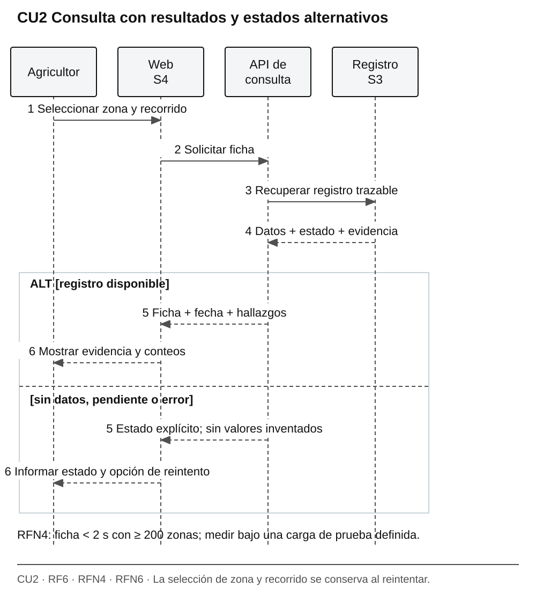

## 2.8. Modelo de procesos de negocio

El proceso actual depende de recorrer las hileras, inspeccionar visualmente, anotar hallazgos y decidir las acciones de manejo. La propuesta conserva la decisión del agricultor e incorpora evidencia registrada. El objetivo del cambio es localizar los hallazgos y facilitar su seguimiento, no automatizar el tratamiento del cultivo.

El BPM propuesto utiliza un proceso con tres carriles: operario, Sabueso y agricultor. El operario prepara la misión; Sabueso patrulla, captura, analiza y registra; el agricultor revisa la ficha y decide si necesita inspección en campo. El rombo representa una decisión exclusiva y los círculos el inicio y el cierre.

Figura 7. Proceso de monitoreo con decisión del agricultor

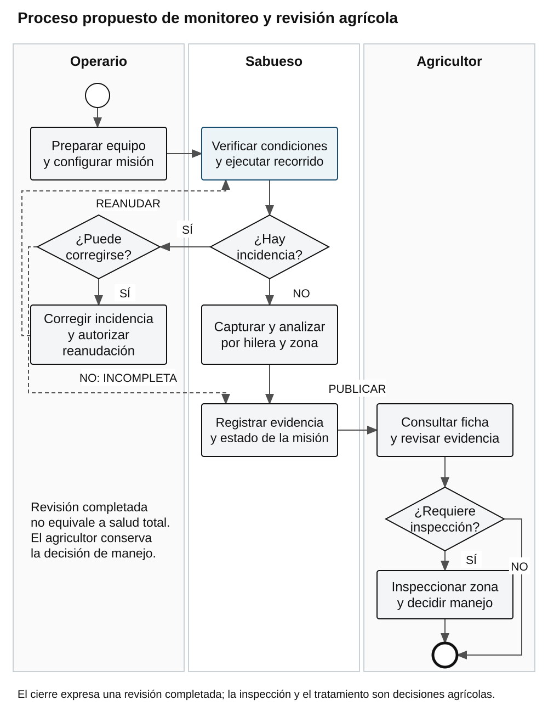

Si la evidencia requiere revisión, el agricultor inspecciona la zona y decide la acción apropiada. Si no la requiere, termina la consulta. El cierre no significa que el cultivo esté libre de problemas: describe únicamente que se completó esa revisión. Las incidencias del recorrido se tratan antes de considerar sus datos completos, conforme a CU1.

Tabla 9. Cambios esperados en el proceso de monitoreo

| Aspecto | Proceso manual | Proceso propuesto |
| --- | --- | --- |
| Localización | Ubicación recordada o anotada informalmente. | Hallazgo asociado con hilera y zona. |
| Evidencia | Observación sin respaldo sistemático. | Capturas e historial por recorrido. |
| Conteo | Conteo visual manual cuando se realiza. | Conteo estimado por madurez, contrastable con referencia manual. |
| Decisión | Depende de la observación inmediata. | El agricultor revisa evidencia y decide si inspecciona o actúa. |

## 2.9. Prototipo y secuencia de interfaces

El prototipo de baja fidelidad presenta la navegación del agricultor y permite revisar comprensión, organización y secuencia antes de implementar la plataforma. Sus contenidos son ilustrativos y no representan mediciones del proyecto. Se propone revisarlo mediante tareas concretas: localizar una zona, abrir su evidencia y comparar un recorrido anterior.

Figura 8. Secuencia de navegación entre el mapa, la ficha y el historial

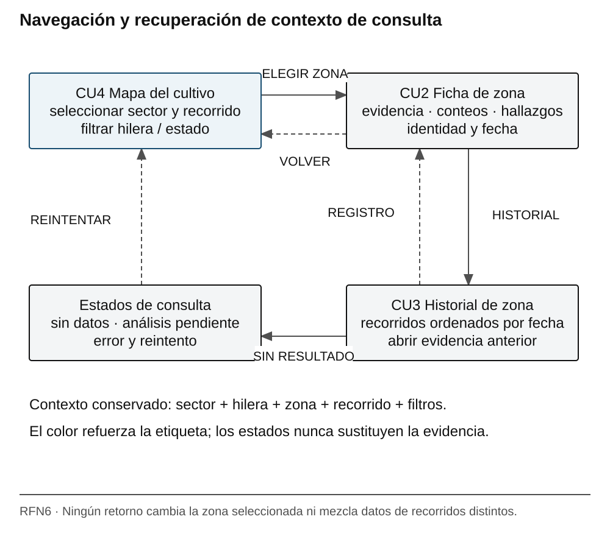

### 2.9.1. Mapa de zonas

La pantalla inicial muestra el sector, el recorrido de referencia y las zonas. El color se acompaña de etiquetas: sin alertas registradas, revisar maleza, revisar follaje y sin datos. “Sin alertas registradas” indica únicamente que no hay una alerta registrada para la observación, no una certificación de salud del cultivo. Seleccionar una zona abre su ficha.

Figura 9. Prototipo de pantalla inicial con estados textuales

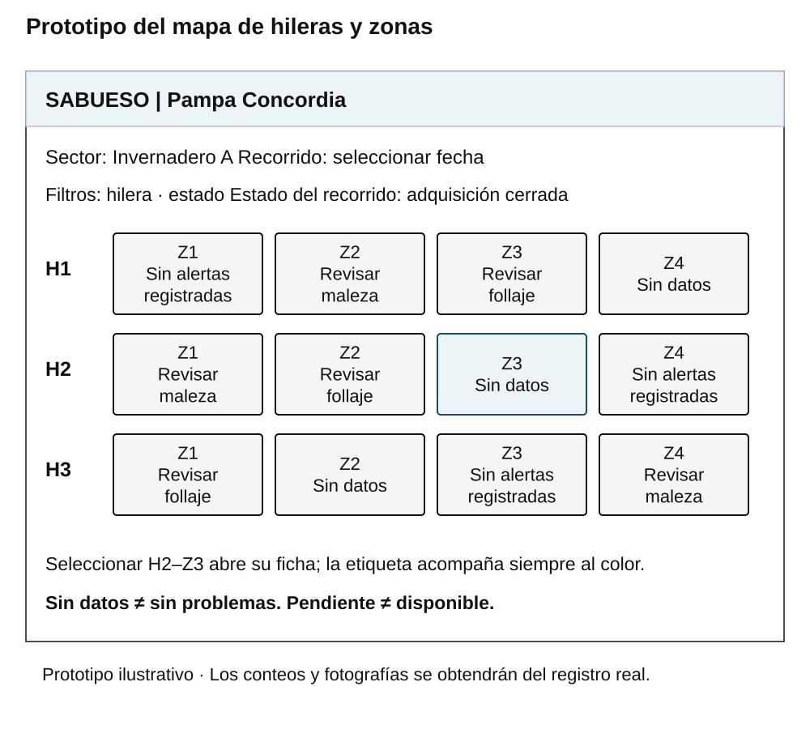

### 2.9.2. Ficha e historial de zona

La ficha identifica hilera, zona y recorrido, y reúne fotografía, conteos por madurez y hallazgos. “Consultar historial” abre los registros de la misma zona; “Volver al mapa” conserva el contexto. Los hallazgos del follaje se expresan como signos por revisar, sin afirmar una enfermedad específica.

Figura 10. Ficha de zona con evidencia y acceso al historial

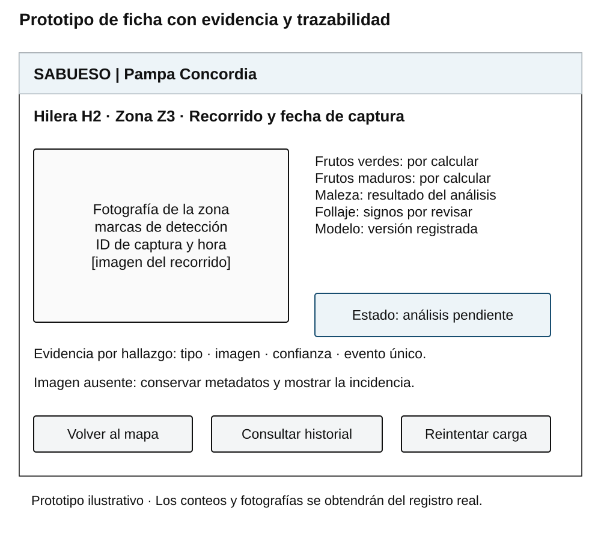

El historial ordena los registros por fecha y permite abrir la evidencia de una visita. Si falta una captura, se informa la ausencia en lugar de reutilizar una fotografía de otro recorrido. La secuencia navegable se conserva en los prototipos HTML del repositorio: mapa, ficha e historial.

Figura 11. Historial ilustrativo con retorno a la ficha de zona

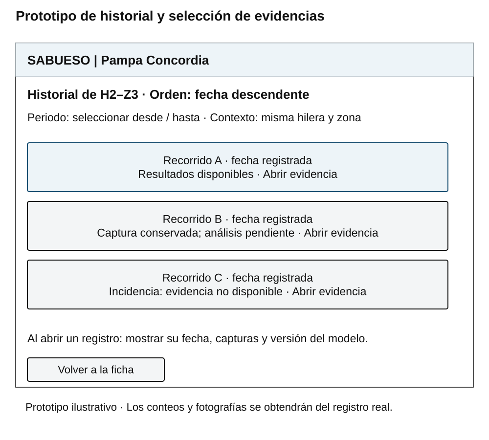

En la revisión con el cliente se observará si puede localizar una zona, interpretar sus estados y recuperar un registro sin ayuda técnica. Las dificultades se convertirán en tareas Kanban con evidencia de corrección. La evaluación de usabilidad comprobará RFN6; los mockups no sustituyen esa evaluación.

## 2.10. Verificación del avance con el cliente

El cliente usuario es Hernán Huanca, productor agrícola del predio Pampa Concordia, Arica. Se cuenta con aprobación documentada del cliente. La referencia y el respaldo correspondiente se incorporarán a esta sección al consolidar la entrega.

La verificación de este avance relaciona el material desarrollado con los diez criterios de la Parte 1. Para la revisión con el cliente se utilizarán el alcance, los modelos y las tareas del prototipo, registrando las observaciones y los acuerdos de modificación sin alterar la línea base de forma unilateral.

# III. REFERENCIAS

[1] Unitree Robotics. Go2. Especificaciones y comparación de configuraciones. https://www.unitree.com/go2

[2] Unitree Robotics. Go2 SDK Development Guide. FAQ y recursos oficiales de desarrollo. https://support.unitree.com/home/en/developer/FAQ ; https://www.unitree.com/mobile/opensource

[3] Afonso, M., et al. (2020). Tomato Fruit Detection and Counting in Greenhouses Using Deep Learning. Frontiers in Plant Science, 11, 571299. https://doi.org/10.3389/fpls.2020.571299

[4] Kanban Guides. (2025). Open Guide to Kanban in the Context of Knowledge Work. https://kanbanguides.org/open-guide-to-kanban

Fuentes del proyecto: Documento de problemática y requisitos de la fase 0 (28 de septiembre de 2026); rúbrica de etapas e informes de Proyecto IV (31 de agosto de 2026); Documento inicial de Proyecto IV 2026; Planificación de Proyecto IV; plantilla institucional formato_serio.docx.
